# Documentacion Tecnica Integral - Barrio Seguro Backend

## 1. Descripcion General y Dominio del Sistema
**Barrio Seguro** es una plataforma backend de alta disponibilidad, diseñada para coordinar la autogestion comunitaria, la prevencion situacional del delito y la articulacion institucional (policia y municipio) en barrios y sectores urbanos.

El sistema fue concebido bajo premisas estrictas de **cero datos simulados**, **descentralizacion sectorial**, **seguridad criptografica de grado de produccion** y **georreferenciacion nativa para OpenStreetMap**.

---

## 2. Ecosistema Tecnologico
- **Lenguaje:** TypeScript 5.8 / Node.js 22 LTS
- **Framework Web:** Express 5.3 con tipado estricto
- **Base de Datos Relacional:** PostgreSQL 18
- **ORM / Mapeo Objeto-Relacional:** Prisma ORM 6.19
- **Seguridad Criptografica:** JSON Web Tokens (`jsonwebtoken`), hashing con `bcryptjs` (salt cost = 10)
- **Validacion de Esquemas:** Zod 3.24
- **Seguridad HTTP:** Helmet, CORS
- **Estandar Geoespacial:** Coordenadas WGS84 (EPSG:4326), RFC 7946 GeoJSON FeatureCollection
- **Documentacion de APIs:** OpenAPI 3.0.3, Swagger UI interactivo (`/api/docs`)
- **Suite de Pruebas:** Supertest + tsx contra base de datos PostgreSQL real

---

## 3. Diagrama y Especificacion de Arquitectura del Backend

La arquitectura del backend de **Barrio Seguro** adopta el patron arquitectonico **Layered Architecture (Arquitectura en Capas)** desacoplada, orientada al dominio y modularizada por componentes de negocio. Garantiza una estricta separacion de responsabilidades (*Separation of Concerns*), trazabilidad perimetral, idempotencia en operaciones criticas y un flujo unidireccional de control.

### 3.1 Diagrama de Arquitectura de Capas y Flujo del Sistema (Mermaid)

```mermaid
flowchart TD
    subgraph CLIENT_LAYER["Capa de Clientes y Consumidores"]
        WEB["Aplicacion Web Ciudadana (Vite / React)"]
        MOBILE["Aplicacion Movil Residentes / Policia (Flutter / React Native)"]
        ADMIN_WEB["Portal Administrativo y Directiva Barrial"]
        SWAGGER_UI["Swagger UI / OpenAPI Explorer (/api/docs)"]
    end

    subgraph PERIMETER_LAYER["Capa Perimetral y de Seguridad HTTP (src/app.ts)"]
        HELMET["Helmet (Cabeceras de Seguridad HTTP)"]
        CORS["CORS Policy (Validacion de Origen)"]
        PARSER["JSON & URL-Encoded Parsers (Limite 10MB)"]
        LOGGER["Morgan Logger (Trazabilidad HTTP)"]
    end

    subgraph ROUTING_LAYER["Capa de Enrutamiento y Despacho (src/routes/index.ts)"]
        ROOT_ROUTER["API Global Router (/api)"]
        DOCS_ROUTER["Swagger Router (/docs)"]
        HEALTH_CHECK["Health Check Handler (/health)"]
    end

    subgraph MIDDLEWARE_LAYER["Capa de Interceptores y Validaciones (src/middlewares/)"]
        JWT_AUTH["authenticateToken (Validacion JWT & Estado de Cuenta)"]
        RBAC_GUARD["authorizeRoles (Guard de Roles: SUPERADMIN, ADMIN, POLICIA, etc.)"]
        ZOD_VALIDATOR["validateRequest (Validacion Estricta Body/Query/Params con Zod)"]
        ERROR_HANDLER["errorHandler (Manejador Centralizado de Excepciones HTTP)"]
    end

    subgraph MODULES_LAYER["Capa de Controladores y Modulos (src/modules/)"]
        direction TB
        subgraph MOD_AUTH["Modulo Autenticacion"]
            AUTH_C["AuthController"]
            AUTH_S["AuthService"]
        end
        subgraph MOD_SECTORS["Modulo Sectores"]
            SEC_C["SectorsController"]
            SEC_S["SectorsService"]
        end
        subgraph MOD_USERS["Modulo Usuarios y Censo"]
            USR_C["UsersController"]
            USR_S["UsersService"]
        end
        subgraph MOD_POIS["Modulo Puntos de Interes"]
            POI_C["PoisController"]
            POI_S["PoisService"]
        end
        subgraph MOD_EVENTS["Modulo Eventos y Asambleas"]
            EVT_C["EventsController"]
            EVT_S["EventsService"]
        end
        subgraph MOD_VACANT["Modulo Casas Vacias"]
            VAC_C["VacantHousesController"]
            VAC_S["VacantHousesService"]
        end
        subgraph MOD_INCIDENTS["Modulo Alertas e Incidentes"]
            INC_C["IncidentsController"]
            INC_S["IncidentsService"]
        end
        subgraph MOD_DASHBOARD["Modulo Dashboard e Inteligencia"]
            DSH_C["DashboardController"]
            DSH_S["DashboardService"]
        end
    end

    subgraph CROSS_CUTTING["Capa Transversal de Utilidades y Nucleo (src/utils/ & src/config/)"]
        GEO_UTILS["GeoUtils (Formula Haversine & GeoJSON RFC 7946)"]
        RESP_UTILS["ResponseUtils (Estandarizacion JSend / JSON Responses)"]
        ENV_CONFIG["ENV Configuration (Tipado Zod de Variables de Entorno)"]
    end

    subgraph PERSISTENCE_LAYER["Capa de Persistencia y Acceso a Datos (src/config/database.ts)"]
        PRISMA_CLIENT["Prisma Client ORM (Query Engine, Connection Pooling & Transactions)"]
    end

    subgraph DATA_STORAGE["Capa de Almacenamiento Relacional (Base de Datos Real)"]
        POSTGRES[("PostgreSQL 18 Database Engine")]
        TABLES["sectors | users | poi_locations | community_events<br/>event_attendances | vacant_houses | vacant_house_logs<br/>incident_alerts | incident_updates | audit_logs"]
    end

    subgraph EXTERNAL_SERVICES["Servicios Externos y Ecosistema Cartografico"]
        OSM["OpenStreetMap Tile Servers / Leaflet GIS"]
    end

    %% Relaciones y Flujos de Comunicacion
    WEB -->|"Peticiones HTTP/REST (JSON)"| HELMET
    MOBILE -->|"Peticiones HTTP/REST (JSON)"| HELMET
    ADMIN_WEB -->|"Peticiones HTTP/REST (JSON)"| HELMET
    SWAGGER_UI -->|"Inspeccion OpenAPI 3.0"| DOCS_ROUTER

    HELMET --> CORS --> PARSER --> LOGGER --> ROOT_ROUTER

    ROOT_ROUTER --> HEALTH_CHECK
    ROOT_ROUTER --> DOCS_ROUTER
    ROOT_ROUTER -->|"/auth"| AUTH_C
    ROOT_ROUTER -->|"/sectors"| SEC_C
    ROOT_ROUTER -->|"/users"| USR_C
    ROOT_ROUTER -->|"/pois"| POI_C
    ROOT_ROUTER -->|"/events"| EVT_C
    ROOT_ROUTER -->|"/vacant-houses"| VAC_C
    ROOT_ROUTER -->|"/incidents"| INC_C
    ROOT_ROUTER -->|"/dashboard"| DSH_C

    %% Interceptores aplicados a rutas
    AUTH_C -.->|"Verifica esquema"| ZOD_VALIDATOR
    SEC_C -.->|"Protegido por"| JWT_AUTH
    SEC_C -.->|"Control de rol"| RBAC_GUARD
    USR_C -.->|"Protegido por"| JWT_AUTH
    POI_C -.->|"Protegido por"| JWT_AUTH
    EVT_C -.->|"Protegido por"| JWT_AUTH
    VAC_C -.->|"Protegido por"| JWT_AUTH
    INC_C -.->|"Protegido por"| JWT_AUTH
    DSH_C -.->|"Protegido por"| JWT_AUTH

    %% Controladores a Servicios
    AUTH_C --> AUTH_S
    SEC_C --> SEC_S
    USR_C --> USR_S
    POI_C --> POI_S
    EVT_C --> EVT_S
    VAC_C --> VAC_S
    INC_C --> INC_S
    DSH_C --> DSH_S

    %% Servicios a Utilidades
    POI_S --> GEO_UTILS
    INC_S --> GEO_UTILS
    AUTH_S -.-> ENV_CONFIG
    AUTH_C -.-> RESP_UTILS
    SEC_C -.-> RESP_UTILS

    %% Excepciones capturadas por ErrorHandler
    AUTH_C -.->|"next(error)"| ERROR_HANDLER
    SEC_C -.->|"next(error)"| ERROR_HANDLER
    USR_C -.->|"next(error)"| ERROR_HANDLER
    POI_C -.->|"next(error)"| ERROR_HANDLER
    EVT_C -.->|"next(error)"| ERROR_HANDLER
    VAC_C -.->|"next(error)"| ERROR_HANDLER
    INC_C -.->|"next(error)"| ERROR_HANDLER
    DSH_C -.->|"next(error)"| ERROR_HANDLER

    %% Servicios a Prisma ORM
    AUTH_S --> PRISMA_CLIENT
    SEC_S --> PRISMA_CLIENT
    USR_S --> PRISMA_CLIENT
    POI_S --> PRISMA_CLIENT
    EVT_S --> PRISMA_CLIENT
    VAC_S --> PRISMA_CLIENT
    INC_S --> PRISMA_CLIENT
    DSH_S --> PRISMA_CLIENT

    %% Prisma a PostgreSQL
    PRISMA_CLIENT -->|"TCP / Connection Pool"| POSTGRES
    POSTGRES --- TABLES

    %% Salida a OpenStreetMap
    POI_S -.->|"GeoJSON RFC 7946"| OSM
    INC_S -.->|"GeoJSON RFC 7946"| OSM
```

### 3.2 Desglose Exhaustivo de las 7 Capas de Arquitectura

1. **Capa 1: Clientes y Consumidores (Consumer Layer)**
   - Interfaces web ciudadanas, portales administrativos de directiva barrial, aplicaciones moviles operativas para policia comunitaria (UPC) y la interfaz interactiva Swagger UI.
   - Todo cliente se comunica mediante el protocolo seguro HTTPS con payloads JSON codificados en UTF-8 y autenticacion Bearer JWT en cabeceras HTTP.

2. **Capa 2: Perimetral y Seguridad HTTP (Edge & Security Layer - `src/app.ts`)**
   - **Helmet:** Establece cabeceras de proteccion contra vulnerabilidades comunes (XSS, Clickjacking, MIME sniffing, HSTS).
   - **CORS Configurable:** Restringe el acceso de origenes permitidos configurados mediante la variable de entorno `CORS_ORIGIN`.
   - **Body Parsers:** Limitan el tamaño maximo de carga a 10MB para prevenir ataques de denegacion de servicio (DoS) por saturacion de memoria.
   - **Morgan Logger:** Registra peticiones en tiempo real con metodos HTTP, rutas de acceso, codigos de estado y tiempos de respuesta (omitido durante ejecucion de pruebas automatizadas para no saturar los logs de testing).

3. **Capa 3: Enrutamiento y Despacho (Routing Layer - `src/routes/index.ts`)**
   - Despachador principal montado sobre el prefijo `/api`.
   - Modulos segregados por dominios claros (`/auth`, `/sectors`, `/users`, `/pois`, `/events`, `/vacant-houses`, `/incidents`, `/dashboard`).
   - Endpoint de latencia cero `/health` para monitorizacion de salud e integracion en orquestadores.
   - Exposicion de documentacion viva `/docs` sirviendo el esquema JSON conforme a OpenAPI 3.0.3.

4. **Capa 4: Interceptores y Validacion (Middleware Layer - `src/middlewares/`)**
   - `authenticateToken`: Extrae y valida la firma del token JWT con algoritmo HMAC-SHA256. Verifica en tiempo real contra la base de datos PostgreSQL que el usuario exista, no este suspendido (`isActive === true`) e inyecta el contexto del usuario autenticado en `req.user`.
   - `authorizeRoles`: Implementa control de acceso basado en roles (RBAC). El rol `SUPERADMIN` cuenta con pase transversal automatico; los demas roles son validados frente a listas blancas especificas por endpoint.
   - `validateRequest`: Intercepta la peticion previa a la ejecucion del controlador y somete los campos de `body`, `query` y `params` a validacion estricta contra esquemas Zod, rechazando solicitudes no conformes con HTTP 400 y descripciones detalladas de cada campo fallido.
   - `errorHandler`: Captura de manera centralizada cualquier excepcion no controlada o error de logica de negocio devuelto con `next(error)`, enviando respuestas consistentes con formato JSON y suprimiendo *stack traces* en entornos de produccion.

5. **Capa 5: Controladores y Servicios de Negocio (Domain Logic Layer - `src/modules/`)**
   - **Controladores (Controllers):** Responsables unicos de gestionar el ciclo de peticion y respuesta HTTP (`req`, `res`, `next`), extraer parametros y delegar la logica a los servicios correspondientes.
   - **Servicios (Services):** Contienen el 100% de las reglas de negocio, logica de capacidad barrial (250 familias), calculos geoespaciales, politicas de privacidad y operaciones transaccionales.

6. **Capa 6: Nucleo Geoespacial y Utilidades Transversales (Core & Utils Layer - `src/utils/`)**
   - `GeoUtils`: Motor de calculo trigonometrico esferico basado en la formula de Haversine para computar distancias geodésicas en kilometros entre coordenadas WGS84, y convertidores de colecciones de modelos a GeoJSON `FeatureCollection` conforme a RFC 7946.
   - `ResponseUtils`: Generadores tipados de respuestas de exito (`sendSuccess`) y fallo (`sendError`) para garantizar homogeneidad en toda la API.
   - `database.ts` & `env.ts`: Inicializacion *singleton* de PrismaClient y validacion de entorno en el arranque con Zod.

7. **Capa 7: Persistencia y Acceso a Datos (Persistence & Database Layer - `prisma/`)**
   - **Prisma ORM:** Abstraccion de conexion, generacion de tipos estáticos TypeScript, control de migraciones y administracion de *connection pooling*.
   - **Motor PostgreSQL 18:** Motor relacional robusto con integridad referencial, borrados en cascada (`onDelete: Cascade`), indices unicos de identificacion y soporte nativo para campos semi-estructurados en `JsonB`.

---

## 4. Diagramas de Clases del Backend

Para brindar una vision completa y formal de la estructura de software del backend, se presentan a continuacion dos diagramas de clases complementarios:
1. **Diagrama de Clases de la Arquitectura de Software:** Modulos, controladores, servicios, middlewares y utilidades.
2. **Diagrama de Clases del Modelo de Dominio y Entidades:** Entidades persistentes de base de datos (Prisma), tipos enumerados, asociaciones y cardinalidades.

---

### 4.1 Diagrama de Clases de la Arquitectura de Software (Mermaid)

Este diagrama modela las clases que componen la logica de ejecucion del backend, sus dependencias mutuas, visibilidad de miembros y metodos estaticos de operacion:

```mermaid
classDiagram
    direction TB

    %% Middlewares & Core Utils
    class AuthMiddleware {
        +authenticateToken(req: Request, res: Response, next: NextFunction): Promise~void~
        +authorizeRoles(...allowedRoles: Role[]): RequestHandler
    }

    class ValidateMiddleware {
        +validateRequest(schema: AnyZodObject): RequestHandler
    }

    class ErrorMiddleware {
        +errorHandler(err: any, req: Request, res: Response, next: NextFunction): Response
    }

    class GeoUtils {
        +calculateHaversineDistance(lat1: number, lon1: number, lat2: number, lon2: number): number
        +toGeoJsonPointFeature(data: GeoPointData): GeoJsonFeature
        +toGeoJsonFeatureCollection(features: GeoJsonFeature[]): GeoJsonFeatureCollection
    }

    class ResponseUtils {
        +sendSuccess(res: Response, data: any, statusCode: number, message: string): Response
        +sendError(res: Response, statusCode: number, message: string, errors: any): Response
    }

    %% Modulo Auth
    class AuthController {
        +register(req: Request, res: Response, next: NextFunction): Promise~void~$
        +login(req: Request, res: Response, next: NextFunction): Promise~void~$
        +getProfile(req: Request, res: Response, next: NextFunction): Promise~void~$
        +changePassword(req: Request, res: Response, next: NextFunction): Promise~void~$
    }

    class AuthService {
        +register(data: RegisterUserInput): Promise~AuthResult~$
        +login(credentials: LoginCredentialsInput): Promise~AuthResult~$
        +getProfile(userId: string): Promise~UserProfileOutput~$
        +changePassword(userId: string, data: ChangePasswordInput): Promise~void~$
    }

    %% Modulo Sectors
    class SectorsController {
        +create(req: Request, res: Response, next: NextFunction): Promise~void~$
        +listAll(req: Request, res: Response, next: NextFunction): Promise~void~$
        +getById(req: Request, res: Response, next: NextFunction): Promise~void~$
        +update(req: Request, res: Response, next: NextFunction): Promise~void~$
        +getStats(req: Request, res: Response, next: NextFunction): Promise~void~$
    }

    class SectorsService {
        +create(data: CreateSectorInput): Promise~Sector~$
        +listAll(filters: SectorFilters): Promise~Sector[]~$
        +getById(id: string): Promise~Sector~$
        +update(id: string, data: UpdateSectorInput): Promise~Sector~$
        +getStats(id: string): Promise~SectorCapacityStats~$
    }

    %% Modulo Users
    class UsersController {
        +censusResident(req: Request, res: Response, next: NextFunction): Promise~void~$
        +listBySector(req: Request, res: Response, next: NextFunction): Promise~void~$
        +getCensusSummary(req: Request, res: Response, next: NextFunction): Promise~void~$
        +updateUserRole(req: Request, res: Response, next: NextFunction): Promise~void~$
    }

    class UsersService {
        +censusResident(data: CensusResidentInput): Promise~User~$
        +listBySector(sectorId: string, roleFilter: Role): Promise~User[]~$
        +getCensusSummary(sectorId: string): Promise~CensusSummaryOutput~$
        +updateUserRole(userId: string, data: UpdateUserRoleInput): Promise~User~$
    }

    %% Modulo POIs
    class PoisController {
        +create(req: Request, res: Response, next: NextFunction): Promise~void~$
        +listAll(req: Request, res: Response, next: NextFunction): Promise~void~$
        +getGeoJson(req: Request, res: Response, next: NextFunction): Promise~void~$
        +findNearby(req: Request, res: Response, next: NextFunction): Promise~void~$
        +getById(req: Request, res: Response, next: NextFunction): Promise~void~$
        +update(req: Request, res: Response, next: NextFunction): Promise~void~$
        +setVerification(req: Request, res: Response, next: NextFunction): Promise~void~$
        +delete(req: Request, res: Response, next: NextFunction): Promise~void~$
    }

    class PoisService {
        +create(data: CreatePoiInput): Promise~PoiLocation~$
        +listAll(filters: PoiFilters): Promise~PoiLocation[]~$
        +getGeoJson(filters: PoiGeoFilters): Promise~GeoJsonFeatureCollection~$
        +findNearby(params: NearbyPoiParams): Promise~PoiWithDistance[]~$
        +getById(id: string): Promise~PoiLocation~$
        +update(id: string, data: UpdatePoiInput): Promise~PoiLocation~$
        +setVerification(id: string, isVerified: boolean): Promise~PoiLocation~$
        +delete(id: string): Promise~PoiLocation~$
    }

    %% Modulo Events
    class EventsController {
        +create(req: Request, res: Response, next: NextFunction): Promise~void~$
        +listAll(req: Request, res: Response, next: NextFunction): Promise~void~$
        +getById(req: Request, res: Response, next: NextFunction): Promise~void~$
        +attend(req: Request, res: Response, next: NextFunction): Promise~void~$
        +cancelAttendance(req: Request, res: Response, next: NextFunction): Promise~void~$
        +updateStatus(req: Request, res: Response, next: NextFunction): Promise~void~$
    }

    class EventsService {
        +create(data: CreateEventInput): Promise~CommunityEvent~$
        +listAll(filters: EventFilters): Promise~CommunityEvent[]~$
        +getById(id: string): Promise~CommunityEvent~$
        +attend(eventId: string, userId: string): Promise~EventAttendance~$
        +cancelAttendance(eventId: string, userId: string): Promise~void~$
        +updateStatus(id: string, status: EventStatus): Promise~CommunityEvent~$
    }

    %% Modulo VacantHouses
    class VacantHousesController {
        +create(req: Request, res: Response, next: NextFunction): Promise~void~$
        +list(req: Request, res: Response, next: NextFunction): Promise~void~$
        +getById(req: Request, res: Response, next: NextFunction): Promise~void~$
        +updateStatus(req: Request, res: Response, next: NextFunction): Promise~void~$
        +addInspectionLog(req: Request, res: Response, next: NextFunction): Promise~void~$
        +getInspectionLogs(req: Request, res: Response, next: NextFunction): Promise~void~$
    }

    class VacantHousesService {
        +create(data: CreateVacantHouseInput): Promise~VacantHouse~$
        +list(user: AuthUserContext, status: VacantHouseStatus): Promise~VacantHouse[]~$
        +getById(id: string, user: AuthUserContext): Promise~VacantHouse~$
        +updateStatus(id: string, status: VacantHouseStatus): Promise~VacantHouse~$
        +addInspectionLog(data: AddInspectionLogInput): Promise~VacantHouseLog~$
        +getInspectionLogs(vacantHouseId: string): Promise~VacantHouseLog[]~$
    }

    %% Modulo Incidents
    class IncidentsController {
        +create(req: Request, res: Response, next: NextFunction): Promise~void~$
        +listAll(req: Request, res: Response, next: NextFunction): Promise~void~$
        +getGeoJson(req: Request, res: Response, next: NextFunction): Promise~void~$
        +getById(req: Request, res: Response, next: NextFunction): Promise~void~$
        +updateStatus(req: Request, res: Response, next: NextFunction): Promise~void~$
        +addUpdate(req: Request, res: Response, next: NextFunction): Promise~void~$
    }

    class IncidentsService {
        +create(data: CreateIncidentInput): Promise~IncidentAlert~$
        +listAll(filters: IncidentFilters): Promise~IncidentAlert[]~$
        +getGeoJson(filters: IncidentGeoFilters): Promise~GeoJsonFeatureCollection~$
        +getById(id: string): Promise~IncidentAlert~$
        +updateStatus(id: string, status: IncidentStatus): Promise~IncidentAlert~$
        +addUpdate(data: AddIncidentUpdateInput): Promise~IncidentUpdate~$
    }

    %% Modulo Dashboard
    class DashboardController {
        +getSectorMetrics(req: Request, res: Response, next: NextFunction): Promise~void~$
        +getGlobalMetrics(req: Request, res: Response, next: NextFunction): Promise~void~$
    }

    class DashboardService {
        +getSectorMetrics(sectorId: string): Promise~SectorDashboardMetrics~$
        +getGlobalMetrics(): Promise~GlobalPlatformMetrics~$
    }

    %% Infraestructura Prisma
    class PrismaClientInstance {
        +sector: PrismaSectorDelegate
        +user: PrismaUserDelegate
        +poiLocation: PrismaPoiDelegate
        +communityEvent: PrismaEventDelegate
        +eventAttendance: PrismaAttendanceDelegate
        +vacantHouse: PrismaVacantHouseDelegate
        +vacantHouseLog: PrismaInspectionLogDelegate
        +incidentAlert: PrismaIncidentDelegate
        +incidentUpdate: PrismaIncidentUpdateDelegate
        +auditLog: PrismaAuditDelegate
        +$transaction(actions: any[]): Promise~any~
    }

    %% Relaciones de dependencia y llamada
    AuthController ..> AuthService : delega a
    AuthController ..> ResponseUtils : formatea respuesta
    SectorsController ..> SectorsService : delega a
    SectorsController ..> ResponseUtils : formatea respuesta
    UsersController ..> UsersService : delega a
    UsersController ..> ResponseUtils : formatea respuesta
    PoisController ..> PoisService : delega a
    PoisController ..> ResponseUtils : formatea respuesta
    EventsController ..> EventsService : delega a
    EventsController ..> ResponseUtils : formatea respuesta
    VacantHousesController ..> VacantHousesService : delega a
    VacantHousesController ..> ResponseUtils : formatea respuesta
    IncidentsController ..> IncidentsService : delega a
    IncidentsController ..> ResponseUtils : formatea respuesta
    DashboardController ..> DashboardService : delega a
    DashboardController ..> ResponseUtils : formatea respuesta

    PoisService ..> GeoUtils : utiliza calculo Haversine y GeoJSON
    IncidentsService ..> GeoUtils : serializa a GeoJSON RFC 7946

    AuthService ..> PrismaClientInstance : persiste mediante
    SectorsService ..> PrismaClientInstance : persiste mediante
    UsersService ..> PrismaClientInstance : persiste mediante
    PoisService ..> PrismaClientInstance : persiste mediante
    EventsService ..> PrismaClientInstance : persiste mediante
    VacantHousesService ..> PrismaClientInstance : persiste mediante
    IncidentsService ..> PrismaClientInstance : persiste mediante
    DashboardService ..> PrismaClientInstance : agrega metricas de
```

---

### 4.2 Diagrama de Clases del Modelo de Dominio y Entidades de Persistencia (Prisma / DB)

Este diagrama representa el modelo entidad-relacion del backend, expresado en la estructura de clases del ORM Prisma, especificando todos los campos, llaves primarias, foraneas, enums de dominio y cardinalidades relacionales:

```mermaid
classDiagram
    direction TB

    %% Enumeraciones de Dominio
    class Role {
        <<enumeration>>
        SUPERADMIN
        ADMIN_SECTOR
        VECINO_LIDER
        RESIDENTE
        AUTORIDAD_POLICIAL
    }

    class SectorStatus {
        <<enumeration>>
        ACTIVO
        INACTIVO
        EN_AUDITORIA
    }

    class PoiType {
        <<enumeration>>
        AREA_VERDE
        PUNTO_SEGURO
        NEGOCIO
        PUNTO_TURISTICO
        MUNICIPIO
        INFOCENTRO
    }

    class EventType {
        <<enumeration>>
        ASAMBLEA_BARRIAL
        MINGA_COMUNITARIA
        SIMULACRO_SEGURIDAD
        REUNION_SEGURIDAD
        ACTIVIDAD_DEPORTIVA_CULTURAL
    }

    class EventStatus {
        <<enumeration>>
        PROGRAMADO
        EN_CURSO
        FINALIZADO
        CANCELADO
    }

    class VacantHouseStatus {
        <<enumeration>>
        REGISTRADA
        VIGILANCIA_ACTIVA
        FINALIZADA
        CANCELADA
    }

    class IncidentCategory {
        <<enumeration>>
        ROBO_HURTO
        SOSPECHOSO
        DISTURBIO_ESCANDALO
        VIOLENCIA
        INFRAESTRUCTURA_DANADA
        ACCIDENTE_TRANSITO
        EMERGENCIA_MEDICA
        OTRO
    }

    class IncidentSeverity {
        <<enumeration>>
        BAJA
        MEDIA
        ALTA
        CRITICA
    }

    class IncidentStatus {
        <<enumeration>>
        EMITIDA
        EN_VERIFICACION
        PATRULLA_DESPACHADA
        RESUELTA
        FALSA_ALARMA
    }

    %% Clases de Entidad
    class Sector {
        +String id [PK]
        +String name
        +String code [UNIQUE]
        +String description
        +String city
        +String provinceState
        +String postalCode
        +Float centerLat
        +Float centerLng
        +Json boundaryGeoJson
        +Int maxFamilies
        +SectorStatus status
        +DateTime createdAt
        +DateTime updatedAt
    }

    class User {
        +String id [PK]
        +String sectorId [FK]
        +String nationalId [UNIQUE]
        +String email [UNIQUE]
        +String passwordHash
        +String firstName
        +String lastName
        +String phone
        +String address
        +String familyUnitCode
        +Role role
        +Boolean isActive
        +DateTime lastLoginAt
        +DateTime createdAt
        +DateTime updatedAt
    }

    class PoiLocation {
        +String id [PK]
        +String sectorId [FK]
        +String createdById [FK]
        +String name
        +PoiType type
        +String description
        +Float latitude
        +Float longitude
        +String address
        +String contactPhone
        +String openingHours
        +Json attributes
        +Boolean isVerified
        +DateTime createdAt
        +DateTime updatedAt
    }

    class CommunityEvent {
        +String id [PK]
        +String sectorId [FK]
        +String organizerId [FK]
        +String title
        +String description
        +EventType eventType
        +Float latitude
        +Float longitude
        +String address
        +DateTime startDate
        +DateTime endDate
        +Boolean isPublic
        +EventStatus status
        +Int attendeesCount
        +DateTime createdAt
        +DateTime updatedAt
    }

    class EventAttendance {
        +String id [PK]
        +String eventId [FK]
        +String userId [FK]
        +DateTime confirmedAt
    }

    class VacantHouse {
        +String id [PK]
        +String sectorId [FK]
        +String residentId [FK]
        +String propertyAddress
        +Float latitude
        +Float longitude
        +DateTime departureDate
        +DateTime returnDate
        +String trustedNeighborName
        +String trustedNeighborPhone
        +String emergencyContactPhone
        +String specialInstructions
        +VacantHouseStatus status
        +DateTime createdAt
        +DateTime updatedAt
    }

    class VacantHouseLog {
        +String id [PK]
        +String vacantHouseId [FK]
        +String inspectorId [FK]
        +DateTime inspectionDate
        +String statusFound
        +String notes
        +DateTime createdAt
    }

    class IncidentAlert {
        +String id [PK]
        +String sectorId [FK]
        +String reportedById [FK]
        +String code [UNIQUE]
        +IncidentCategory category
        +IncidentSeverity severity
        +String title
        +String description
        +Float latitude
        +Float longitude
        +String addressReference
        +IncidentStatus status
        +Boolean isAnonymous
        +String[] evidenceUrls
        +DateTime createdAt
        +DateTime updatedAt
    }

    class IncidentUpdate {
        +String id [PK]
        +String incidentId [FK]
        +String authorId [FK]
        +IncidentStatus status
        +String comment
        +String officerBadge
        +DateTime createdAt
    }

    class AuditLog {
        +String id [PK]
        +String sectorId [FK]
        +String userId [FK]
        +String action
        +String entity
        +String entityId
        +String ipAddress
        +Json details
        +DateTime createdAt
    }

    %% Asociaciones de Dominio y Enums
    Sector --> SectorStatus : tiene estado
    User --> Role : posee rol
    PoiLocation --> PoiType : clasificado como
    CommunityEvent --> EventType : tipificado como
    CommunityEvent --> EventStatus : gestiona estado
    VacantHouse --> VacantHouseStatus : monitorizado en estado
    IncidentAlert --> IncidentCategory : clasificado por categoria
    IncidentAlert --> IncidentSeverity : evaluado con severidad
    IncidentAlert --> IncidentStatus : evoluciona en estado
    IncidentUpdate --> IncidentStatus : registra cambio a estado

    %% Cardinalidades entre Entidades
    Sector "1" --> "0..*" User : alberga residentes
    Sector "1" --> "0..*" PoiLocation : delimita puntos de interes
    Sector "1" --> "0..*" CommunityEvent : aloja asambleas y eventos
    Sector "1" --> "0..*" VacantHouse : contiene viviendas
    Sector "1" --> "0..*" IncidentAlert : circunscribe incidentes
    Sector "1" --> "0..*" AuditLog : registra eventos de auditoria

    User "1" --> "0..*" PoiLocation : registra o sugiere
    User "1" --> "0..*" CommunityEvent : convoca u organiza
    User "1" --> "0..*" EventAttendance : confirma asistencia
    User "1" --> "0..*" VacantHouse : registra ausencia temporal
    User "1" --> "0..*" VacantHouseLog : oficial realiza patrullaje
    User "1" --> "0..*" IncidentAlert : emite denuncia ciudadana
    User "1" --> "0..*" IncidentUpdate : oficial/admin añade bitacora
    User "1" --> "0..*" AuditLog : genera traza de auditoria

    CommunityEvent "1" --> "0..*" EventAttendance : registra participantes
    VacantHouse "1" --> "0..*" VacantHouseLog : acumula bitacora policial
    IncidentAlert "1" --> "0..*" IncidentUpdate : acumula actualizaciones de despacho
```

---

## 5. Modelo de Capacidad y Reglas de Negocio Barrial

### 5.1 Control de Capacidad (200 a 250 Familias por Sector)
- Cada sector urbano o rural opera como una entidad territorial independiente.
- Cada sector posee un parametro `maxFamilies` con valor estandar de **250 familias** (soporta un rango de 200 a 250 familias por sector).
- Los residentes se vinculan a un `familyUnitCode` (unidad familiar). Miembros adicionales de una misma familia no consumen cupos adicionales.
- Al censar un nuevo residente que inaugura una nueva unidad familiar, el sistema evalua en tiempo de ejecucion:
  $$\text{Familias Existentes} + 1 \le \text{maxFamilies}$$
  Si el limite es alcanzado, el backend bloquea la operacion con HTTP 400, indicando la obligatoriedad de aperturar un nuevo sector o subsector territorial.

### 5.2 Gobernanza de Roles (RBAC)
1. **SUPERADMIN:** Maximo nivel jerarquico; supervision global y gestion de sectores a nivel metropolitano.
2. **ADMIN_SECTOR:** Administrador barrial o directiva del sector; censa familias, aprueba o verifica negocios y puntos geograficos.
3. **VECINO_LIDER:** Coordinador de manzana o cuadra; convoca a reuniones de seguridad y apoya la resolucion comunitaria.
4. **RESIDENTE:** Ciudadano verificado; emite denuncias, registra su vivienda en ausencia temporal y consulta el mapa y eventos.
5. **AUTORIDAD_POLICIAL:** Agente de policia comunitaria (UPC); atiende alertas ciudadanas, actualiza estados de patrullaje y registra rondas en casas vacias.

---

## 6. Integracion Cartografica con OpenStreetMap (OSM)

La plataforma no utiliza servicios propietarios cerrados de mapas. El backend implementa soporte nativo para **OpenStreetMap**:
1. **Coordenadas WGS84:** Latitud y longitud almacenadas como flotantes de doble precision en PostgreSQL.
2. **FeatureCollection GeoJSON (RFC 7946):** Los endpoints `/api/pois/geojson` y `/api/incidents/geojson` generan objetos GeoJSON puros con geometrias `Point` y `Polygon` consumibles directamente por **Leaflet**, **OpenLayers** o componentes frontend de mapa.
3. **Formula de Haversine:** Implementacion en `src/utils/geo.utils.ts` para calculos exactos de proximidad euclidiana sobre la curvatura terrestre ($R = 6371\text{ km}$):
   $$d = 2R \arcsin\left(\sqrt{\sin^2\left(\frac{\Delta \phi}{2}\right) + \cos(\phi_1)\cos(\phi_2)\sin^2\left(\frac{\Delta \lambda}{2}\right)}\right)$$
   Permite ordenar puntos de interes e incidentes por cercania respecto a la ubicacion del ciudadano en el endpoint `/api/pois/nearby`.

---

## 7. Modulos Funcionales del Backend

### 7.1 Modulo de Autenticacion y Usuarios (`/api/auth`, `/api/users`)
- Registro de residentes asociados a sectores activos.
- Login con generacion de JWT que incorpora `userId`, `email`, `role`, `sectorId` y `familyUnitCode`.
- Actualizacion de contraseñas con validacion de fortaleza (mayuscula, numero, minimo 8 caracteres).
- Censo barrial con resumen de ocupacion familiar y distribucion de roles.

### 7.2 Modulo de Sectores Independientes (`/api/sectors`)
- Registro de sectores con delimitacion poligonal GeoJSON y coordenadas centrales.
- Monitoreo de cupos disponibles y porcentaje de ocupacion de familias.
- Endpoint de metricas y consolidado territorial por sector.

### 7.3 Modulo de Mapeo y Puntos de Interes (`/api/pois`)
- Catalogo clasificado en 6 categorias operativas:
  - `PUNTO_SEGURO`: Zonas de encuentro y evacuacion ante sismos, alarmas comunitarias, botones de panico.
  - `AREA_VERDE`: Parques, senderos y complejos deportivos comunitarios.
  - `NEGOCIO`: Comercios de barrio, farmacias, tiendas y talleres locales.
  - `PUNTO_TURISTICO`: Sitios patrimoniales, miradores y centros culturales.
  - `MUNICIPIO`: Administraciones zonales, casas comunales y agencias de atencion ciudadana.
  - `INFOCENTRO`: Puntos comunitarios de internet publico y ciudadania digital.
- Filtros por sector, tipo, texto y radio de proximidad en kilometros.
- Mecanismo de aprobacion/verificacion por administradores barriales.

### 7.4 Modulo de Eventos y Asambleas Barriales (`/api/events`)
- Convocatoria a asambleas, mingas comunitarias, simulacros y actividades deportivas georreferenciadas.
- Confirmacion atomica de asistencia mediante transacciones en PostgreSQL (`attendeesCount`).
- Filtros de eventos proximos y estados (PROGRAMADO, EN_CURSO, FINALIZADO, CANCELADO).

### 7.5 Modulo Preventivo de Casas Vacias (`/api/vacant-houses`)
- Notificacion de ausencia temporal por viaje con fechas de partida y retorno.
- Registro de vecino de confianza de contacto y telefonos de emergencia.
- **Politica de Privacidad Estricta:** Los residentes solo pueden visualizar las casas vacias que ellos mismos registraron. La Policia Comunitaria y los Administradores de Sector tienen acceso restringido para fines de patrullaje.
- **Bitacora Policial:** Registro inmutable de rondas de patrullaje (`vacant_house_logs`) con fecha, identificacion del oficial, estado de la vivienda (ej. "SIN_NOVEDAD") y observaciones.

### 7.6 Modulo Reactivo de Denuncias Ciudadanas (`/api/incidents`)
- Emision de alertas con tipificacion (`ROBO_HURTO`, `SOSPECHOSO`, `DISTURBIO_ESCANDALO`, `VIOLENCIA`, `INFRAESTRUCTURA_DANADA`, `ACCIDENTE_TRANSITO`, `EMERGENCIA_MEDICA`, `OTRO`).
- Niveles de severidad (`BAJA`, `MEDIA`, `ALTA`, `CRITICA`).
- Geolocalizacion precisa sobre mapa.
- Opcion de reporte anonimo (`isAnonymous: true`) que protege la identidad del denunciante en listas y consultas publicas.
- Codigos correlativos unicos anuales (`ALR-2026-XXXX`).
- Ciclo de vida y atencion policial: `EMITIDA` -> `EN_VERIFICACION` -> `PATRULLA_DESPACHADA` -> `RESUELTA` / `FALSA_ALARMA`.
- Bitacora cronologica de seguimiento (`incident_updates`) con oficial asignado y comentarios inmutables.

### 7.7 Modulo de Dashboard e Inteligencia Barrial (`/api/dashboard`)
- Metricas del sector: Capacidad de familias, porcentaje de ocupacion, desglose de POIs, resumen de incidentes por severidad y estado, casas vacias en vigilancia activa y eventos comunitarios proximos.
- Metricas globales para administracion central.

---

## 8. Documentacion Interactiva OpenAPI / Swagger
- URL interactiva: `http://localhost:3000/api/docs`
- Especificacion JSON: `src/swagger/swagger.json`
- Incluye esquemas de peticion, respuestas tipadas, componentes de seguridad BearerAuth y codigos de error HTTP estandarizados.

---

## 9. Verificacion y Pruebas con Base de Datos Real
- **Comando de ejecucion:** `npm test`
- La suite ejecuta 10 escenarios de integracion end-to-end contra PostgreSQL real validando:
  1. Health check del servidor.
  2. Autenticacion con Superadmin, Administrador, Residente y Policia.
  3. Rechazo ante contraseñas erroneas (HTTP 401).
  4. Proteccion de rutas privadas con JWT y RBAC.
  5. Censo de familias y control de capacidad del sector.
  6. Mapeo de POIs, exportacion GeoJSON y calculo Haversine.
  7. Convocatoria y asistencia a asambleas barriales.
  8. Notificacion de casas vacias, privacidad y bitacora de patrullaje policial.
  9. Alertas ciudadanas geolocalizadas, anonimato y despacho de patrulla.
  10. Dashboard sectorial y global.
